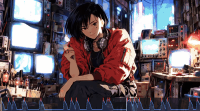
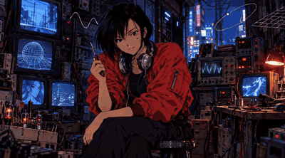
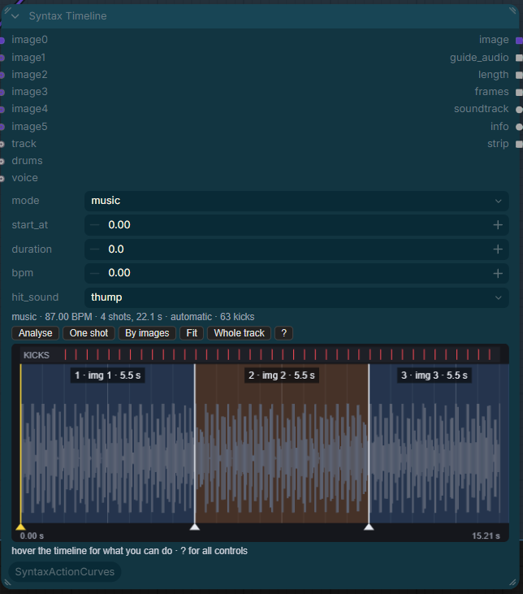

# ComfyUI Syntax Audio Timeline

Turn a track and a few images into a cut, synced MiniMax H3 video: shots cut on the beat or in the pauses, with the action in each shot timed to its part of the sound. Music, dialogue or action, and action needs no audio at all: mark where you want the hits.

Two nodes. Everything else in the workflows is core ComfyUI.

| Music: cut on the beat | Dialogue: cut in the pauses | Action: cut between hits |
| --- | --- | --- |
|  |  |  |

## Quick start

1. **Install**: clone this repo into `ComfyUI/custom_nodes/` and restart ComfyUI. No extra Python packages.
   `timeline_base` also uses [audio-separation-nodes-comfyui](https://github.com/christian-byrne/audio-separation-nodes-comfyui) to split the drums and the voice out of your track (Comfy Cloud has it). To run without it, delete it and load a drums stem file, or let the track guide.
2. **Models** (from [Comfy-Org/MiniMax-H3](https://huggingface.co/Comfy-Org/MiniMax-H3)):

   | File | Folder |
   | --- | --- |
   | `minimax_h3_ref2va_pruned_int8_convrot.safetensors` | `models/diffusion_models` |
   | `qwen3vl_32b_minimax_h3_int8_convrot.safetensors` (or `..._nvfp4_awq` on RTX 50-series) | `models/text_encoders` |
   | `minimax_h3_video_vae_fp16.safetensors`, `minimax_h3_audio_vae_fp32.safetensors` | `models/vae` |
   | `pika_h3_flex_fl2va_v1_bf16.safetensors` | `models/loras` |

3. **Run**: drag `example_workflows/timeline_base.json` into ComfyUI, load your track and images, pick a *mode* and press Run. Its note explains what to change. It runs the pika LoRA at 8 steps and CFG 1.

## The timeline

**Syntax Timeline** takes your track and any number of images and cuts the track into shots. Pick a **mode**:

- **music**: shots of whole bars from the downbeat after *start_at*, each guided by just the **kick drum hits** of its part of the song: the node finds the kicks and puts a clean thump on each, nothing else of the song. Connect the drums stem to **drums** (Audio Separation -> Drums) for clean kicks; from a full mix alone, hard bass notes can count as kicks too. The beat grid is set on the kicks, so cuts land on the beat. *bpm* 0 finds the tempo.
- **dialogue**: cuts moved into the pauses, so no line is cut in half, each shot guided by its part of the **voice** (Audio Separation -> Vocals, or the track if it is only voice).
- **action**: cuts moved between hits, each shot guided by its part of the track plus the hits and sounds you draw on the timeline. With no track, the timeline is blank and what you draw is the sound.

*duration* is how long the video runs from *start_at*, split across the images; 0 gives about 5.5 s per image for music and runs to the end of the sound otherwise. Each shot hears its part of the guide from its first frame, so H3 times the action to it. The finished video carries your original track.

The editor on the node shows the shots right away, and the track's waveform (at once from a Load Audio wired straight in, otherwise after *Analyse*). Hover it for hints; **?** lists every control.



- **Range**: drag the yellow handles to set where the video starts and ends.
- **Shots**: drag a white cut to move it, double-click a shot to split it, right-click a cut to merge the two shots. *One shot* makes a single shot over the whole range; *By images* goes back to one shot per image. More shots than images reuse the images in order, so one image can fill 30 s as one shot or several.
- **Kicks** (music, the top lane): the kick drum hits the last run found.
- **Hits** (action, the top lane): double-click to add a hit, double-click a hit to change its sound (thump for punches, crash for smashes, boom for explosions), drag to move it, right-click to delete it. New hits get *hit_sound*.
- **Drawing** (action, the big area): pick a sound in the **Draw** row (flow: wind, water, light; motor: an engine revving; pulse: magic, sci-fi; mumble: someone talking) and drag to draw it. Higher is louder or faster; draw over a part to redraw it, right-drag to erase, the sound's x clears it. In action the shots sit in the strip along the bottom: double-click it to split a shot.
- music snaps cuts to bars; hold Alt for beats, Shift to move freely.
- **Analyse** runs just the Timeline (and what feeds it) to find the beat, the kicks, the waveform and the exact cuts without rendering.

**Syntax Preview Strip** is optional: it draws the guide's loudness, the cuts, the hits and a playhead along the bottom of each shot, to check that the action lands. Delete it for a clean video.

## Getting good results

- **CFG lands the hits.** The full model at 30 steps and CFG 5, with the negative zeroed *before* the guide (*ConditioningZeroOut* on the Reference to Video output), pushes the picture onto the sound: motion vs drum hits +0.89 on a 5 s test clip. The 4-step turbo LoRA at CFG 1 followed only loosely (+0.27), and raising CFG on a LoRA burns the image. `timeline_base` runs the pika LoRA at 8 steps and CFG 1 for speed; bypass the LoRA and use 30 steps and CFG 5 for the hardest hits.
- **Find the kicks in the drums stem.** On a busy mix, an 808 or metal, hard bass notes look like kicks; the stem has no bass.
- **Ask for stillness between hits.** A prompt that implies constant motion ignores the guide.
- **One reference image per shot** holds the character, setting and palette (`<Picture 1>` in the prompt).
- **An anchor for hard styles.** To keep a hard style or a character the same across cuts, connect a character or style sheet to *Reference to Video*'s second image slot (every shot gets it) and add *drawn in the art style of `<Picture 2>`* to the prompt. Use a sheet, not a scene: with a full scene as the anchor, H3 animated the anchor instead of the shot's own image in 2 of 4 shots.
- **Name the speaker** when a shot has two people, or the wrong one may talk.
- **Long shots need Context Windows.** Past 15 s, H3's trained range, keep *MiniMax H3 Context Windows* on the model (as in `timeline_base`): the look holds for 30 s and more, but motion follows the beat more loosely than in short shots.

[recipes.md](recipes.md) has the prompts, settings and timings behind the clips above.

## Nodes

All under `SyntaxNodes/Timeline`.

| Node | What it does |
| --- | --- |
| **Syntax Timeline** | Cuts the track into shots for music, dialogue or action. Outputs lists (image, guide audio, frames to generate, frames to keep, strip), so the nodes after it run once per shot, plus the soundtrack and an *info* line. |
| **Syntax Preview Strip** | Draws a shot's part of the sync strip along the bottom of its frames. |

Join the shots with core nodes: *Get Image from Batch* (length from *frames*) and *Create Video* per shot, then *Concatenate Video* with the Timeline's *soundtrack* in *complete_audio*.

## Credits

The idea of steering H3's action with a guide sound comes from [Nekodificador] & Adobe Max :D

## License

MIT, see [LICENSE](LICENSE).

## Tests

From `ComfyUI/custom_nodes`:

```
python -m pytest ComfyUI-SyntaxActionCurves/tests --import-mode=importlib
```
