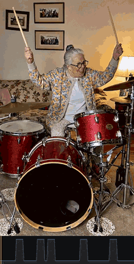

# ComfyUI Syntax Action Curves

Draw a curve, and the video's action lands on it: a punch, a hammer blow or a line of dialogue on every peak, rest in the valleys. No training. Built for MiniMax H3; the prompt-blend method works on any video model.

| Hammer blows | Bass drop | Cymbal crashes |
| --- | --- | --- |
|  |  |  |

The strip under each clip is the curve, with the yellow playhead. With sound: [forge](docs/forge.mp4), [cockpit dialogue](docs/cockpit.mp4), [talking cat](docs/cat.mp4).

## Quick start

1. **Install**: clone this repo into `ComfyUI/custom_nodes/` and restart ComfyUI. No extra Python packages. Needs a ComfyUI recent enough to have the MiniMax H3 nodes (tested on v0.45.2).
2. **Models** (from [Comfy-Org/MiniMax-H3](https://huggingface.co/Comfy-Org/MiniMax-H3), the same files the MiniMax H3 templates use):

   | File | Folder |
   | --- | --- |
   | `minimax_h3_fl2va_pruned_int8_convrot.safetensors` | `models/diffusion_models` |
   | `qwen3vl_32b_minimax_h3_int8_convrot.safetensors` (or `..._nvfp4_awq` on RTX 50-series) | `models/text_encoders` |
   | `minimax_h3_video_vae_fp16.safetensors` | `models/vae` |
   | `minimax_h3_audio_vae_fp32.safetensors` | `models/vae` |

3. **Run**: drag `example_workflows/h3_sound_guide_hits.json` into ComfyUI and press Run. Each workflow has a note explaining what to change. Full H3 at 30 steps is slow (about an hour per 1344x768 clip on a DGX Spark), so lower *width*/*height* for quick tests.

## Which method?

| You want | Use | Example workflow |
| --- | --- | --- |
| Hits on MiniMax H3: punches, blows, beats, impacts | Curve to Guide Audio (thump / crash / boom) → H3 Sound Guide, *guide_steps* 1 | `h3_sound_guide_hits` |
| Dialogue timing on MiniMax H3: who talks when, real pauses | Curve to Guide Audio (murmur) → H3 Sound Guide, *guide_steps* 0.3 | `h3_sound_guide_dialogue` |
| Any other video model (LTX, Wan...) | Conditioning Blend between a calm and an action prompt, plus Guidance | `h3_conditioning_blend` |
| Action timed to existing music or a voice track | Plug the audio straight into H3 Sound Guide, or turn it into a curve with Audio to Curve | |

On MiniMax H3 the sound guide follows the curve most tightly. [recipes.md](recipes.md) has the prompts, curves and settings behind every example clip.

## Drawing the curve

In the **Action Curve Editor**: click to add a key, drag to move it, right-click to delete it. *Presets* has pulses, ramps, hits and more; *Copy*/*Paste* move curves as JSON. Set *length* to the video's frame count; the curve is stretched to fit anyway.

- For hits (thump, crash, boom), each rise past 0.5 is one hit. Narrow spikes work best, about 0.05 of the timeline wide (0.3 s). Height above 0.5 doesn't change the hit.
- For wind and murmur, the sound is as loud as the curve, so height matters.
- For dialogue, draw one plateau per line and gaps for the pauses.

## Controlling the audio

The curve decides **when** there is sound. What it sounds like depends on *guide_steps*:

- ***guide_steps* 1: the guide is the soundtrack.** The built-in sound ends up in the output almost unchanged, with silence between hits. Pick a sound that suits the scene, or plug a real one-shot (a punch, a slam, a cymbal) into *sound_clip* and it plays on every hit.
- ***guide_steps* ~0.3: the guide sets the timing, the model writes the audio.** This is how dialogue gets real voices: put each line in quotes in the prompt, in order. 0.2 lets speech leak into the pauses; 0.4 copies the murmur into the soundtrack.
- **Your own soundtrack**: H3 Sound Guide takes any audio, so a music or voice track can drive the timing directly. Since the picture is timed to the guide, you can also replace the soundtrack with a final mix afterwards.

## Tips

- Keep one plain prompt that agrees with the sound. A prompt that fights it wins.
- Ask for stillness between hits ("holds his guard still"). A prompt that implies constant action ("a drummer playing") ignores the hits.
- Make the negative with *ConditioningZeroOut* from the positive *before* H3 Sound Guide, as in the examples.
- Results vary by seed, so try two or three.
- Conditioning Blend: keep *strength* at 1 for spikes and short hits. On H3 at CFG 5, strength above 1 on a hit shorter than ~0.5 s decodes as corrupted green/magenta frames.

## Nodes

All under `SyntaxNodes/Action Curves`.

| Node | What it does |
| --- | --- |
| **Syntax Action Curve Editor** | Canvas curve editor with presets. Outputs an `ACTION_CURVE` (one 0..1 value per frame). |
| **Syntax Multi Curve Mixer** | max / add / multiply / average / min / subtract over any number of curves. |
| **Syntax Audio to Curve** | Curve from a soundtrack's loudness, or a spike on every onset (beats, hits). |
| **Syntax Curve to Guide Audio** | Curve → guide sound: thump, crash or boom on every rise past 0.5, a wind or murmur bed as loud as the curve, or your own *sound_clip* on every rise. |
| **Syntax H3 Sound Guide** | Anchors the guide sound at frame 0 of a MiniMax H3 video, for all steps or only the first *guide_steps*. |
| **Syntax Action Curve Apply (Conditioning Blend)** | Blends a base and an action prompt frame by frame. Any video model. |
| **Syntax Action Curve Apply (Guidance)** | Per-frame CFG that follows the curve. Needs CFG > 1. |
| **Syntax Action Curve Apply (H3 Fun ControlNet)** | Drop-in for *Apply MiniMax H3 Fun ControlNet* with per-frame strength from the curve. Not yet tested end to end. |
| **Syntax Curve to Control Video** | Renders the curve as control frames (bounce, pulse, intensity, meter) for a ControlNet. |
| **Syntax Curve Preview Overlay** | Burns the curve and a playhead into the bottom of a video, to check the action lands on it. |

## How it works

- **Sound guide**: H3 generates picture and sound together and keeps them in sync, so a guide soundtrack anchored at frame 0 (the same mechanism as core *Add Guide for MiniMax H3*) pulls the action onto its hits. *guide_steps* below 1 applies the guide only to the first part of sampling (a timestep range on the positive) and the plain positive for the rest. Measured on full H3 at CFG 5: punches +0.81/+0.60 motion correlation with the curve over two seeds, dialogue +0.88 loudness correlation.
- **Conditioning Blend** gives the base and action positives complementary per-frame masks (`1 - curve`, `curve`), so the sampler averages the two predictions frame by frame. On audio+video latents (H3, LTX) the audio stream is weighted along its own time axis. The action prompt inherits the base positive's guides and references, so encode it with the same image-to-video node. *strength* above 1 pushes past the action prompt, like CFG between the two prompts. *hard_switch* splits into prompt segments where the curve crosses 0.5. Costs one extra positive pass per step. Best H3 result: short square hits, strength 1, Guidance 0.6 (+0.61/+0.74).
- **Guidance** sets CFG to `1 + (cfg - 1) * curve` on each latent frame. No effect at CFG 1 (distilled models).
- **H3 Fun ControlNet** scales the control on each video frame's tokens by the curve. Pair it with *Curve to Control Video*.

## Credits

The sound-guide method (curve → synthetic sound → MiniMax H3 audio guide, released after part of the steps) comes from [Nekodificador](https://x.com/Nekodificador)'s event curves in [ComfyUI-NKD-Basic-Tools](https://github.com/Nekodificador/ComfyUI-NKD-Basic-Tools). The sound synthesis here is a separate implementation.

## Tests

From `ComfyUI/custom_nodes`:

```
python -m pytest ComfyUI-SyntaxActionCurves/tests --import-mode=importlib
```
